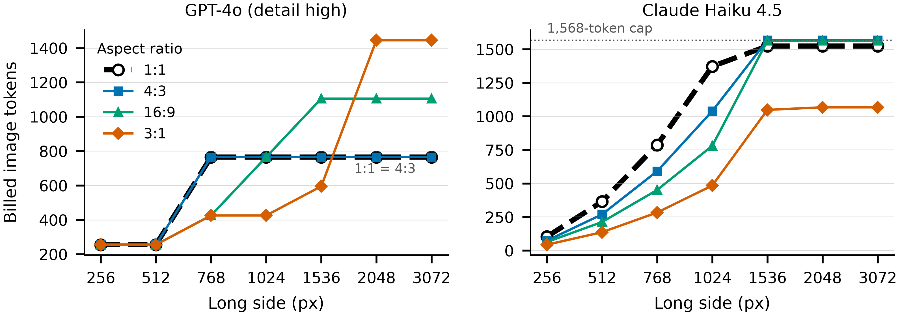
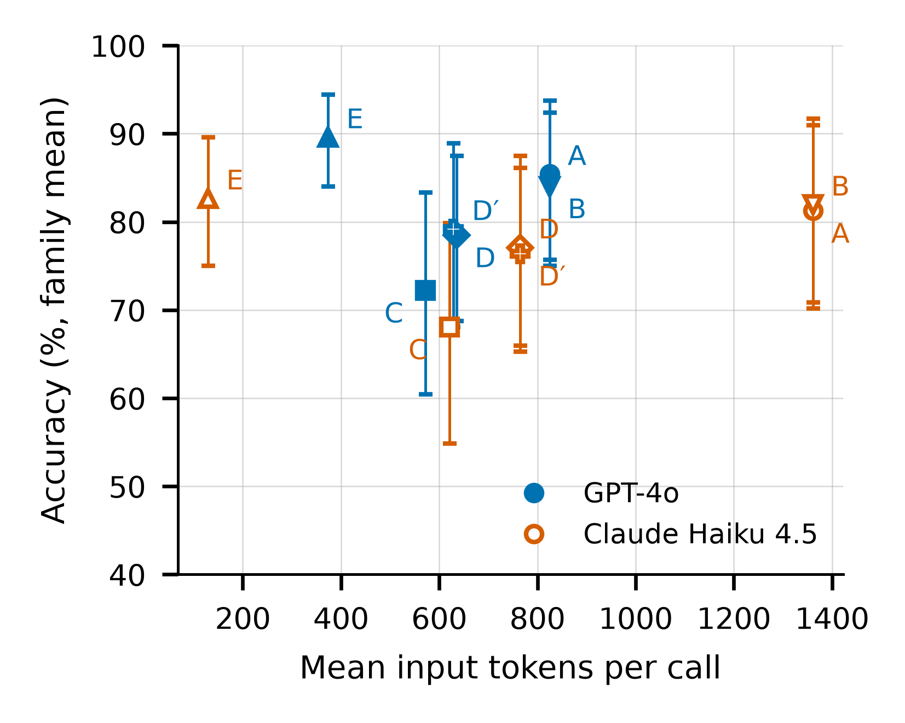
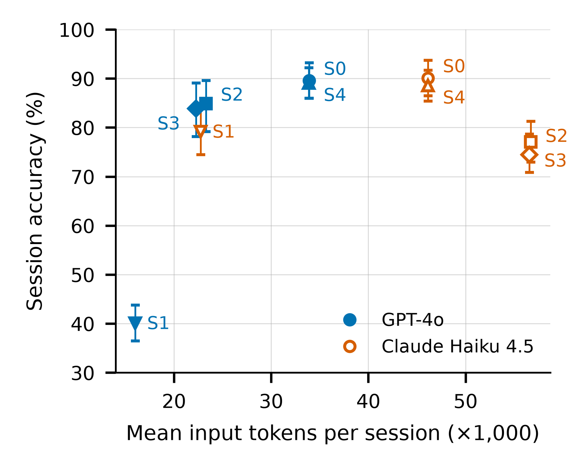
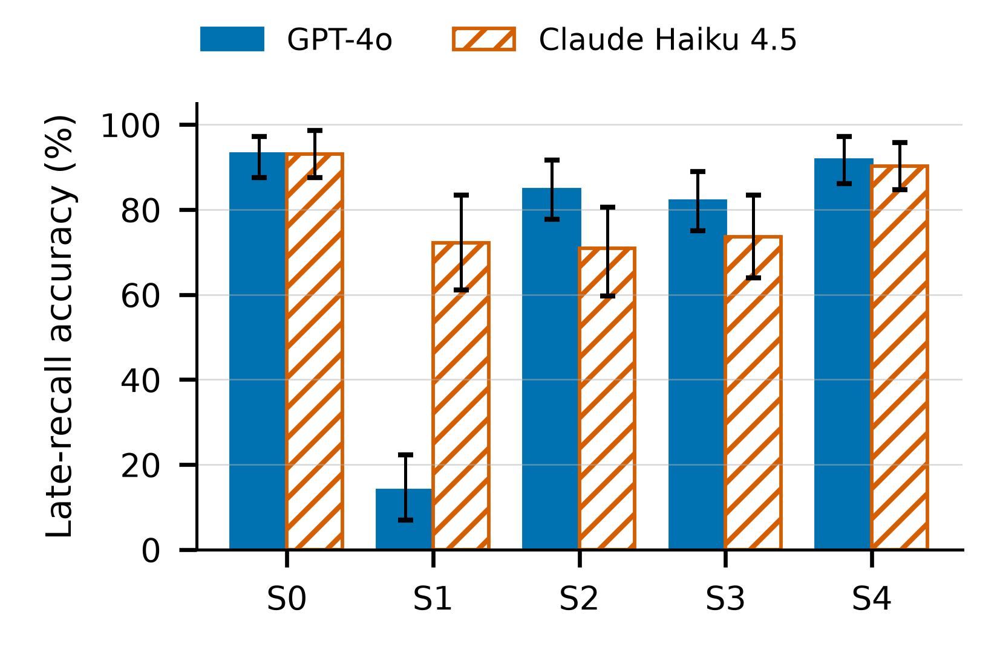

# 에이전트 작업 흐름을 위한 원본 보존형 멀티모달 컨텍스트 최적화: 공급자 청구 토큰과 정확도의 실측

**Source-preserving multimodal context optimization for agent workflows: measuring provider-billed tokens and accuracy**

## 국문요약

에이전트 세션에서는 텍스트와 이미지가 누적되어 다음 요청에 다시 전송된다. 손실 요약인 compact는 문맥을 줄이지만 앞선 증거를 잃을 수 있다. 본 연구는 원본을 외부에 보존하고 출처와 함께 필요한 부분을 발췌하는 방식으로 compact를 보완하고, 공급자 청구 토큰과 정확도를 세 실험으로 측정한다. 실험 1에서 GPT-4o detail high의 청구 이미지 토큰은 공개 회계식과 66/66 일치했다. 단일 질의 실험 2에서 영역 선택과 원본 재요청(D)은 배정 원본(A) 대비 입력 토큰을 GPT-4o 23.0%, Haiku 4.5 43.8% 줄였으나, 두 공급자 모두 정확도의 비열등성은 입증되지 않았다. 세션 실험 3의 사전 등록 held-out 세션에서 GPT-4o는 compact 모사 단독보다 발췌·compact 결합에서 늦은 회상이 13.9%에서 81.9%로 높아졌으나, Haiku 4.5에서는 같은 개선이 지지되지 않았다. 세션에서도 두 공급자 모두 전체 유지 대비 정확도의 비열등성이 입증되지 않았고, 캐시를 반영하면 GPT-4o 비용 절감은 9.1%로 줄었으며 Haiku 비용은 증가했다. 결과는 공급자와 조건에 한정되며 전체 유지의 대체나 모든 공급자의 비용 절감을 주장하지 않는다. [출처: `research/results/rq1-sweep-001/README.md:29`, `research/results/exp2-heldout/README.md:28-29`, `research/results/s3-heldout/gpt4o/analysis.md:11-14,24`, `research/results/s3-heldout/haiku/analysis.md:11-14`, `research/results/s3-heldout/README.md:37`, E3-5–E3-14]

**주제어:** 멀티모달 컨텍스트, 원본 보존, 에이전트 세션, 청구 토큰, 정확도

## English Abstract

Agent sessions retransmit accumulated text and images, and lossy compaction can discard earlier evidence. We complement compaction by preserving sources outside the context and returning selected evidence with provenance, and we measure provider-billed tokens and accuracy in three experiments. In experiment 1, GPT-4o billed image tokens at detail high matched the public accounting rule in 66/66 cases. In the single-query experiment 2, region selection plus requery of the original (D) reduced input tokens relative to the assigned original (A) by 23.0% for GPT-4o and 43.8% for Haiku 4.5, but accuracy non-inferiority was not established for either provider. In the preregistered held-out sessions of experiment 3, GPT-4o late recall rose from 13.9% with simulated compaction alone to 81.9% with source-preserving retrieval plus compaction, but the same improvement was not supported for Haiku 4.5. In the sessions, non-inferiority against keeping all context was likewise not established for either provider; GPT-4o’s list-price saving fell to 9.1% after prompt caching, while Haiku cost increased. The findings are limited to these providers and conditions. [Sources: `research/results/rq1-sweep-001/README.md:29`, `research/results/exp2-heldout/README.md:28-29`, `research/results/s3-heldout/gpt4o/analysis.md:11-14,24`, `research/results/s3-heldout/haiku/analysis.md:11-14`, `research/results/s3-heldout/README.md:37`, E3-5–E3-14]

**Keywords:** multimodal context, source preservation, agent sessions, billed tokens, accuracy

## I. 서론: 문제와 경계

에이전트 세션에는 텍스트와 이미지가 누적되며 다음 요청에 다시 전송된다. compact는 손실 요약으로 누적 문맥을 줄이지만 앞선 증거를 잃을 수 있다. 원본을 외부에 두고 필요한 증거를 출처와 함께 발췌하는 구조는 compact를 보완한다. 원본 보존·재조회 컨텍스트 관리는 텍스트 에이전트의 DTOC [1]와 ACM [2]에서 제안되었다. 본 연구는 이를 이미지 입력과 공급자 청구 토큰으로 확장하고, compact와의 관계를 사전 등록 실험으로 측정한다.

이미지는 문서 질의응답, 차트 해석, 앱 화면 이해에서 답의 근거를 직접 담는다 [3]–[6]. 파일 바이트가 줄었다는 사실만으로 입력 최적화가 안전하다고 결론 낼 수 없다. 질문에 맞춘 축소가 답을 결정하는 증거를 지울 수 있다.

본 제안은 질문과 이미지의 제한된 신호를 이용해 후보 영역을 선택하고 고정된 출력 변환을 적용한다. 단일 질의에서 `UNREADABLE` 표지가 있으면 같은 배정 variant를 최대 한 번 다시 요청한다. 소프트웨어 아티팩트(경로·해시·변환 이력)와 시각적 손상 아티팩트(축소·재인코딩·잘림으로 변한 픽셀)를 구분한다. 현재 제품에는 호출자가 영역을 정하는 `crop_image_artifact`가 있으나, 이 실험은 연구용 OCR 선택기 경로를 평가했으며 제품 crop 도구를 평가하지 않았다.

범위는 텍스트와 정적 이미지이며 영상은 후속 연구로 남긴다. 현재 저장소의 입력 검증·해시·치수 추적(M1a)은 영구 원본 보관이나 OCR 결합기를 제공하지 않는다. 구체적인 프로필과 한계는 [입력 계약](../image-artifacts.md)에 기록한다.

새 crop·pruning 알고리즘의 우월성이나 최초 평가를 주장하지 않는다.

**RQ1.** 클라이언트 변환(resize, JPEG 재인코딩, crop)은 공급자별 청구 이미지 토큰을 어떻게 바꾸는가? **RQ2.** 단일 질의에서 질의 인식 발췌와 판독 불가 기반 원본 재요청은 정확도를 유지하며 토큰을 줄이는가? **RQ3.** 다중 턴 세션에서 원본 보존 발췌는 전체 유지 및 compact 단독과 비교해 누적 청구 토큰, 과제 정확도와 늦은 회상을 어떻게 바꾸는가?

**C1 — 측정.** GPT-4o와 Claude Haiku 4.5의 이미지 청구 토큰을 클라이언트 변환별로 측정하고 공개 회계식과 대조한다.

**C2 — 시스템.** 텍스트 에이전트에서 제안된 원본 보존·재조회 구조 [1], [2]를 이미지 입력으로 확장하는 MCP 플러그인 설계다. 이미지는 원래 해상도 영역 crop, 저해상도 전체 썸네일, 원본 재요청으로 다룬다. 영역은 호출자가 정하며, 실험에서는 OCR 기반 질의 인식 선택기를 호출자로 사용한다. 텍스트는 LLM 없이 원문 줄과 출처를 붙여 발췌한다. 이미지 확장 설계와 현재 제품의 구현 범위는 III장에서 구분한다.

**C3 — 세션 평가.** 다중 턴 세션에서 전체 유지, compact 모사, 원본 보존 발췌, 그 조합을 사전 등록 held-out으로 비교한다. 비용은 두 공급자의 청구 토큰으로 정가와 캐시 반영을 나눠 잰다.

이 설계를 사전 등록한 단일 질의와 세션에서 평가한 결과는 V·VI장과 두 결과 부록에 보고한다.

**C4 — 경계와 부정적 결과.** 사전 등록 비열등성은 입증되지 않았고, 세션에서 GPT-4o의 비용 절감은 캐시를 반영하면 줄었으며 Haiku에서는 비용이 증가했다. 이는 −5%p 이상 열등하다는 입증과 다르며 원본 재요청의 안전성이나 모든 공급자에서의 비용 절감을 뜻하지 않는다. [출처: `research/results/exp2-heldout/README.md:28-29`, `research/results/s3-heldout/README.md:25-37`, E2-7–E2-11, E3-5–E3-8]

## II. 관련 연구와 제안의 위치

DocVQA·TextVQA·ChartQA·ScreenQA [3]–[6]는 문서·문자·차트·화면의 픽셀 증거를 평가한다. QuietPrune·Rethinking Token Reduction [7], [8]은 모델 내부 축소이고, LLMLingua·RECOMP [9], [10]은 텍스트 압축이다. DTOC·ACM [1], [2]은 외부 원본 보존·재조회의 선행 연구이며, The Complexity Trap·Screenshots or Tools?·HiconAgent [11]–[13]은 관측 축소를 다룬다. 본 연구는 원본 보존을 새 원리로 주장하지 않고 공급자 API 앞단 crop·썸네일·재요청과 청구 비용을 측정한다.

| 연구 | 매체 | 개입 위치 | 평가 단위 | 경계 |
|---|---|---|---|---|
| [7], [8] 시각 토큰 축소 | 이미지·텍스트 | 모델 내부 | 시각 질의 | 외부 변환·과금과 별개 |
| [9], [10] 텍스트 압축 | 텍스트 | API 앞단 | 프롬프트·검색 | 문장 선택 |
| [1], [2] DTOC·ACM | 텍스트 | 외부 저장·관리 | 에이전트 세션 | 원본 재조회 선행 연구 |
| [11] 관측 마스킹 | 텍스트 | 컨텍스트 관리 | 에이전트 세션 | 요약 대비 관측 마스킹 |
| [12] GUI–MCP 에이전트 | 이미지·텍스트 | 관측 규칙·RL | GUI–MCP 과제 | 제거 이미지 재조회와 구분 |
| [13] HiconAgent | 이미지·텍스트 | 내부 토큰 제거·정책 | GUI 과제 | 제거 이미지 재조회와 구분 |
| 본 연구: 원본 보존 발췌 | 텍스트·이미지 | 공급자 API 앞단 | 단일 질의·세션 | crop·썸네일·재요청·청구 비용 |

파일 바이트·내부 연산량 감소와 공급자 청구 토큰 감소는 다르므로 공개 회계식·실제 사용량·캐시·재요청 비용을 함께 계산한다.

## III. 제안 방법

### 3.1 원본 보존 인터페이스

실험 하네스는 원문 전체 대신 아티팩트 카드(ID·종류·제목·크기)를 전달하고 필요한 증거를 ID로 조회한다. 제품의 `index_artifact`는 ID·경로·해시·바이트 수·줄 수·라벨 메타데이터를 반환한다. `query_artifact`는 LLM 없이 원문 줄과 줄 번호·해시를 반환하며, 실험의 `query_text_artifact`가 실제 MCP 도구를 호출한다.

이미지 확장 설계의 `query_image_artifact`는 호출자가 정한 영역 crop과 전체 썸네일을 반환하고 원본 해시·좌표로 출처를 연결한다. `get_original_image`는 ID에 해당하는 원본을 요청한다. 이 두 도구는 제품 MCP에 구현되지 않았으며 연구용 하네스가 모사한다. 실험에서는 OCR 선택기를 호출자로 사용한다. 현재 제품의 `crop_image_artifact`는 호출자가 영역을 제공하는 도구이고 이 실험의 평가 대상이 아니다.

compact 요약에는 아티팩트 ID를 남긴다. 이는 실험 하네스의 지시이며 제품 compact 내부 동작이나 영구 원본 보관 기능을 구현했다는 뜻이 아니다. 이미지 입력 검증·원본 추적과 아래 연구 평가 경로를 구분한다.

### 3.2 이미지 선택과 재요청

선택기는 질문과 배정된 픽셀의 OCR 신호만 사용한다. 숨은 정답·gold evidence와 손상 조건의 canonical clean 이미지는 제공하지 않는다. family 안의 변형과 near-duplicate를 교차 split하지 않는다. 선택기는 영역만 정하며 출력 형식이나 quality를 고르지 않는다. 활성 출력은 긴 변 1536 이하 downscale(확대 없음) 뒤 JPEG quality 75다. crop을 사용하는 arm은 crop 뒤 같은 변환을 적용한다. 목표 프로필 `jpeg-ycbcr8-baseline-444-v1`의 실제 encoder 적합성은 검증되지 않았다. 세부 입력·변환 규칙은 [프로토콜](./image-first-evaluation-protocol.md)에 둔다.

선택기는 `selectWindow`, OCR은 `tesseract.js 5.1.1`이며 실험 2 하네스·분석은 `dbf4f6b`에서 동결했다. 연구 경로의 sharp 0.35.4/libvips 8.18.6과 제품 jpeg-js probe를 구분한다. 제품 probe의 확인을 연구 encoder의 출력 적합성으로 옮기지 않는다. [출처: `research/src/selector.mjs:81`, `research/package.json:21`, `research/results/exp2-heldout/README.md:5`, `research/plans/2026-10-18-task38-number-sheet.md` §6, E2-1]

사전 OCR guard는 없으며 첫 응답의 대소문자 구분 없는 `UNREADABLE` substring만 검사한다. 표지가 있으면 같은 배정 variant를 변환 없이 최대 한 번 재요청한다. 손상 조건에서 원본 재요청은 손상된 입력으로 돌아갈 뿐 숨은 clean 이미지를 복구하지 않는다. 응답·실제 variant·crop 경계·변환 이력을 기록하며 재요청이 가독성을 보장한다고 해석하지 않는다.

### 3.3 비용과 관측

파일 바이트, 전처리·선택 지연, 공급자 사용량, 오류·timeout을 분리 계측한다. 사용량이 없으면 0이 아니라 unknown으로 남긴다. 정가와 캐시 반영 비용을 함께 계산하고 회계식과 실제 사용량을 구분한다. 원본 보존·경로 안전성·manifest 완전성은 모델 정확도와 별도로 확인한다.

## IV. 공급자 회계와 실험 1

공식 문서의 예제 치수 산술은 실측 절감률이 아니다 [14]–[24]. 실험 1은 GPT-4o와 Claude Haiku 4.5의 변환 입력 사용량을 공개 회계식과 대조했다. 전체 66장은 49개 격자 측정, 10개 경계 사례, 7개 JPEG q75 재전송으로 구성됐고 그림 1에는 대표 종횡비의 격자점 28개만 표시했다. GPT-4o detail high는 66/66에서 예측과 일치했고, Haiku는 단일 이미지 요청에서 예측보다 3토큰 많았다. PNG와 JPEG q75의 7개 재전송 쌍은 두 공급자에서 같았다. [출처: `research/results/rq1-sweep-001/README.md:8-11,29-35`, `research/figures/README.md:30,36-46`, R1-2–R1-8]

공식 문서의 예제 치수 회계는 gpt-4o-2024-11-20 [14]–[15], claude-haiku-4-5-20251001 [17]–[19], gemini-3.8-flash [21]–[24]를 비교하고, claude-sonnet-5-5 [17], [18], [20]와 gpt-5.6-sol [14], [16]은 별도 회계 계열의 대조로 둔다. 이 값은 공개 회계식의 산술이며 실제 사용량·실측 절감률·파일럿 모델 선정·청구액이 아니다. `gemini-3.8-flash`의 명목 budget 비교는 Δ=0이지만 실제 사용량은 unknown이고 [21]–[24], GPT-5.6 Sol의 거부는 자동 축소가 아니다 [14], [16]. 상세 계산은 [계산 예제와 상세 근거](./image-token-cost-models.md)에 둔다.

그림 1. GPT-4o와 Haiku 4.5의 공급자 청구 이미지 토큰 실측. [출처: `research/figures/README.md:36-46`]

## V. 실험 2: 단일 질의

실험 2는 사전 등록한 36개 held-out family에 clean, JPEG q50, 1024 축소, 1024 축소+JPEG 조건을 적용했다. A는 배정 원본, B는 전체 1536/q75 변환, C는 OCR 영역 선택, D는 C와 같은 입력의 별도 첫 호출 뒤 `UNREADABLE` 시 원본 1회 재요청, E는 정답 영역 진단이다. D는 두 호출 사용량을 합산한다. held-out 호출 전 개정 1에서 D 정의와 primary를 D−A로 고정했다. D′는 개정 전 규칙의 탐색 결과다. 상세 설계·확정값과 조건별 결과는 [프로토콜](./image-first-evaluation-protocol.md)과 [실험 2 결과 부록](./2026-10-16-experiment2-results.md)에 둔다. [출처: `research/results/exp2-heldout/README.md:7-17,36-41`, `research/plans/2026-10-16-experiment2-preregistration-draft.md:79-104`, E2-1–E2-9]

표 1. 실험 2 사전 등록 가설 판정. 괄호는 family 단위 짝 bootstrap 95% CI다. [출처: `research/results/exp2-heldout/gpt4o/exp2-analysis.md:7-9`, `research/results/exp2-heldout/haiku/exp2-analysis.md:7-9`, E2-7–E2-9]

| 가설 | GPT-4o | Haiku 4.5 | 판정 |
|---|---:|---:|---|
| H1: D−A, 하한 > −5%p이고 D 토큰 < A | −6.9%p [−15.3, 0.7], 635 < 824 | −4.2%p [−13.2, 3.5], 765 < 1,361 | 지지 안 됨 |
| H2: D−C | +6.3%p [1.4, 12.5] | +9.0%p [2.8, 16.7] | 기술 통계 |
| H3: C−B | −11.8%p [−22.9, −2.1] | −13.9%p [−25.0, −3.5] | 기술 통계 |

두 공급자 모두 H1은 지지되지 않았다. 이는 비열등성 미입증이며 −5%p 이상 열등하다는 입증은 아니다. clean·JPEG q50에서 A와 D 정확도는 두 공급자 모두 88.9%였다. 네 조건 평균 D 입력 토큰은 A 대비 GPT-4o 23.0%, Haiku 43.8% 감소했다. D 재요청은 각각 11/144와 16/144, 재요청 뒤 정답은 9/11과 13/16이었다. 표지 없는 오답과 D′·레이아웃 탐색은 결과 부록에 보고한다. [출처: `research/results/exp2-heldout/README.md:28-29,47-50,59-66,74-83`, E2-10–E2-11, E2-18–E2-30]

그림 5. 실험 2 held-out arm별 family 평균 정확도와 입력 토큰. 오차 막대는 기술 통계인 family bootstrap 95% 구간이다. [출처: `research/figures/exp2/README.md:19-24`]

## VI. 실험 3: 에이전트 세션

### 6.1 프로토콜과 재현 경로

세 템플릿의 8턴 고정 대본과 24 held-out 세션의 설계는 [실험 3 프로토콜](./2026-10-15-experiment3-protocol.md)에, 결과는 [결과 부록](./2026-10-15-experiment3-results.md)에 둔다. 재현에는 실행 코드 `7914a44` 작업 트리의 번들을 사용한다. 당시 텍스트 도구는 최고점 줄 주변 한 구간만 반환했으며, 다중 반환으로 바뀐 현재 제품 번들로 재실행한 결과는 동일 재현이 아니다. [출처: `research/results/s3-heldout/README.md:3-19`, `docs/research/2026-10-15-experiment3-protocol.md:68-77`, E3-1–E3-4]

### 6.2 조건과 측정

S0은 전체 유지, S1은 compact 모사, S2는 원본 보존 발췌, S3는 발췌+compact, S4는 1536/q75 축소 유지다. S1·S3은 턴 3·6 뒤 고정 일정으로 요약한다. S2·S3의 이미지 조회는 OCR 영역 crop과 전체 썸네일을 반환하며, 영역 미발견 시에는 썸네일 없이 전체 arm 변환 이미지를 반환한다. `UNREADABLE` 응답에는 그 턴에 제시했거나 마지막으로 조회한 이미지 원본을 최대 한 번 자동 제공한다. 도구 왕복과 compact 호출도 누적 사용량에 포함한다. [출처: `docs/research/2026-10-15-experiment3-protocol.md:26-38,52`, E3-1]

### 6.3 분할과 지표

주 분석은 GPT-4o, 보조 분석은 Haiku 4.5다. 기존·새 레이아웃은 각각 12세션이며 주 지표는 세션 평균 내용 정확도다. 늦은 회상은 턴 6–8의 정확도다. 세션 단위 짝 bootstrap은 10,000회, 기준 seed `20261015`, percentile 95%로 고정했고 가설별 스트림은 프로토콜에 둔다. 실패·timeout은 오답, `not_started`는 별도로 보고하며 세션을 제외하지 않는다. 미실행이 있으면 완료 연구로 보고하지 않는다. 이번 실행은 실패·미실행이 없었다. [출처: `research/results/s3-heldout/README.md:7-19`, `docs/research/2026-10-15-experiment3-protocol.md:26,48,52-56`, E3-2–E3-4]

### 6.4 결과

가격과 캐시 배율은 2026-10-18 확인한 공급자 공개 가격표를 따른다 [25], [26]. GPT-4o는 캐시 입력 읽기 0.5배, Haiku 4.5는 5분 캐시 쓰기 1.25배와 읽기 0.1배를 적용했다. 가격표에는 `gpt-4o-2024-11-20` 스냅샷의 별도 행이 없어 같은 `gpt-4o` 행을 적용했다. [출처: `research/results/s3-heldout/README.md:50-54`, `research/plans/2026-10-18-task38-number-sheet.md` §4, C-1–C-2]

표 2. 실험 3 가설 판정과 S0/S2 세션당 비용(USD) 패널. 괄호는 세션 단위 짝 bootstrap 95% CI다. Haiku H4는 형식상 성립하지만 S2 비용은 S0보다 높다. [출처: `research/results/s3-heldout/gpt4o/analysis.md:9-14`, `research/results/s3-heldout/haiku/analysis.md:9-14`, `research/results/s3-heldout/README.md:23-37,42-48`, E3-5–E3-14]

| 가설 | GPT-4o | Haiku 4.5 | 판정 |
|---|---:|---:|---|
| H1: S2−S0 정확도 하한 > −5%p, 토큰 S2 < S0 | −4.7%p [−8.9, −0.5], 23,295 < 33,892 | −13.0%p [−17.2, −8.3], 56,696 > 46,143 | 지지 안 됨 |
| H2: S1−S0 늦은 회상 상한 < 0 | −79.2%p [−88.9, −69.4] | −20.8%p [−29.2, −12.5] | 지지 |
| H3: S3−S1 늦은 회상 하한 > 0 | +68.1%p [+58.3, +77.8] | +1.4%p [−15.3, +18.1] | GPT-4o 지지, Haiku 지지 안 됨 |
| H4: S2 캐시 절감률 < 정가 절감률(기술 통계) | 28.5% → 9.1% | −33.0% → −266.4% | 두 공급자 모두 성립 |

| 조건 | GPT-4o 정가 / 캐시 | Haiku 정가 / 캐시 |
|---|---:|---:|
| S0 전체 유지 | $0.0850 / $0.0518 | $0.0464 / $0.0148 |
| S2 원본 보존 발췌 | $0.0608 / $0.0470 | $0.0617 / $0.0544 |

GPT-4o의 S1 늦은 회상은 13.9%, S3은 81.9%였다. [출처: `research/results/s3-heldout/gpt4o/analysis.md:24`, E3-6–E3-7] S2 정확도는 84.9%, S0은 89.6%였고 입력은 23,295 대 33,892토큰으로 31% 낮았다. [출처: `research/results/s3-heldout/gpt4o/analysis.md:20`, `research/results/s3-heldout/gpt4o/summary.md:7-11`, `research/results/s3-heldout/README.md:31`, E3-9–E3-14] Haiku에서는 S3 개선이 지지되지 않았고 S2 토큰·비용이 줄지 않았다. [출처: `research/results/s3-heldout/haiku/analysis.md:24`, `research/results/s3-heldout/README.md:31-37`]

GPT-4o의 발췌·compact 결합 관찰과 공급자 간 차이는 DTOC의 ablation 및 모델별 차이 [1]와 방향을 같이한다. 캐시를 반영한 비용 해석은 요약 시 캐시 재사용이 제한된다는 관측 마스킹 연구 [11]의 논의와 연결된다. 데이터·개입이 달라 동일 효과나 인과 검증으로 해석하지 않는다.

그림 2. held-out 24세션의 조건별 세션 평균 정확도와 세션당 평균 입력 토큰. 오차 막대는 기술 통계인 세션 bootstrap 95% 구간이다. [출처: `research/figures/README.md:48-52`]

그림 3. held-out 24세션의 조건별 늦은 회상 정확도. 오차 막대는 기술 통계인 세션 bootstrap 95% 구간이다. [출처: `research/figures/README.md:54-56`]

## VII. 논의와 한계

합성 이미지와 고정 대본은 실제 문서 다양성과 자율 에이전트 행동을 대표하지 않는다. 공급자별 모델·회계·캐시 조건의 차이로 결과를 다른 공급자에 일반화할 수 없다. compact는 공개 규칙의 모사이며 제품 내부 compact의 성능 평가가 아니다. 이탈과 조용한 오답 사례는 결과 부록에 둔다.

실험 당시 텍스트 도구는 최고점 줄 하나 주변 한 구간을 반환했다. 고정 규칙 벤치에서는 식별자 질의의 동점 때문에 근거 줄을 놓쳤다. 제품 개선(Task 39: 동점 구간 기본 최대 5개와 `moreMatches`) 뒤 held-out entity 질의의 근거 포함은 20/24에서 24/24가 됐다. 이는 반환된 어느 발췌에든 근거 줄이 포함되는지의 값이며 모델 정확도가 아니다. 실제 세션 질의는 기록되지 않아 오답과는 세션 일치까지만 확인했고 원인을 확정하지 않는다. 기존 held-out 결과는 유지하며 개선 효과를 정확도로 주장하려면 새 사전 등록이 필요하다. [출처: `research/results/excerpt-bench-001/README.md` §1, `research/results/excerpt-bench-002/README.md:27-43`, `research/results/s3-heldout/README.md:63-77`, E3-21]

## VIII. 결론과 후속 연구

원본 보존형 컨텍스트 관리는 정적 이미지의 증거와 비용을 함께 측정해야 한다. 본 결과는 단일 질의에서 비열등성을 입증하지 못했고, 세션에서는 GPT-4o에 한해 발췌·compact 결합의 늦은 회상 개선을 관찰했다. 세션에서도 두 공급자 모두 비열등성이 입증되지 않았고, Haiku에서는 비용이 증가했다. 후속 연구는 공급자·데이터·대본을 넓혀 원본 재요청과 캐시 비용을 사전 등록해야 한다.

## 참고문헌

[1] A. Chaturvedi, S. Bhattacharya, R. Gopalkrishnan, and P. van der Putten, "DTOC: Dynamic tool output compression for adaptive context management in AI agents," in *Discovery Science (DS 2026)*, Lect. Notes Comput. Sci., vol. 17130, pp. 333–347, Mainz, Germany, Oct. 2026, doi: 10.1007/978-3-032-41086-3_22, arXiv:2609.26121.

[2] X. Li, R. Ming, M. Chu, S. Shao, R. Jin, and C. Xiong, "ACM: Agentic context management for long horizon tasks," arXiv:2607.23809, 2026.

[3] M. Mathew, D. Karatzas, and C. V. Jawahar, "DocVQA: A dataset for VQA on document images," in *Proc. IEEE/CVF Winter Conf. Appl. Comput. Vis. (WACV)*, pp. 2199–2208, Waikoloa, HI, USA, Jan. 2021, doi: 10.1109/WACV48630.2021.00225.

[4] A. Masry, D. X. Long, J. Q. Tan, S. Joty, and E. Hoque, "ChartQA: A benchmark for question answering about charts with visual and logical reasoning," in *Findings Assoc. Comput. Linguist.: ACL 2022*, pp. 2263–2279, Dublin, Ireland, May 2022, doi: 10.18653/v1/2022.findings-acl.177.

[5] Y.-C. Hsiao, F. Zubach, G. Baechler, S. Sunkara, V. Carbune, J. Lin, M. Wang, Y. Zhu, and J. Chen, "ScreenQA: Large-scale question-answer pairs over mobile app screenshots," in *Proc. 2025 Conf. Nations Americas Chapter Assoc. Comput. Linguist.: Hum. Lang. Technol. (NAACL), Vol. 1 (Long Papers)*, pp. 9427–9452, Albuquerque, NM, USA, Apr. 2025, doi: 10.18653/v1/2025.naacl-long.477.

[6] A. Singh, V. Natarajan, M. Shah, Y. Jiang, X. Chen, D. Batra, D. Parikh, and M. Rohrbach, "Towards VQA models that can read," in *Proc. IEEE/CVF Conf. Comput. Vis. Pattern Recognit. (CVPR)*, pp. 8309–8318, Long Beach, CA, USA, Jun. 2019, doi: 10.1109/CVPR.2019.00851.

[7] T. Gao, S. Zhao, S. Fang, S. Zhu, and C. Ma, "QuietPrune: Query-guided early token pruning for vision-language models," in *Proc. IEEE/CVF Conf. Comput. Vis. Pattern Recognit. (CVPR)*, pp. 3553–3562, Denver, CO, USA, Jun. 2026.

[8] Y. Wang, H. Zhang, Q. Huang, A. Cao, G. Fang, W. Wang, X. Jin, J. Song, M. Song, and X. Wang, "Rethinking token reduction for large vision-language models," in *Proc. IEEE/CVF Conf. Comput. Vis. Pattern Recognit. (CVPR)*, pp. 24727–24737, Denver, CO, USA, Jun. 2026.

[9] H. Jiang, Q. Wu, C.-Y. Lin, Y. Yang, and L. Qiu, "LLMLingua: Compressing prompts for accelerated inference of large language models," arXiv:2310.05736, 2023.

[10] F. Xu, W. Shi, and E. Choi, "RECOMP: Improving retrieval-augmented LMs with compression and selective augmentation," arXiv:2310.04408, 2023.

[11] T. Lindenbauer, I. Slinko, L. Felder, E. Bogomolov, and Y. Zharov, "The complexity trap: Simple observation masking is as efficient as LLM summarization for agent context management," in *4th Workshop Deep Learn. Code (DL4C), NeurIPS 2025*, San Diego, CA, USA, Dec. 2025, arXiv:2508.21433.

[12] S. Fan, M. Li, X. Ma, W. Tan, X. Huang, J. Wu, L. Zhang, S. Shang, and W. Chen, "Screenshots or tools? Eliciting tool use and managing multimodal context in hybrid GUI–MCP computer-use agents," arXiv:2608.03327v2, 2026.

[13] X. Zhou, G. Chen, Y. Xie, Z. Li, K. Zhou, S. Wang, S. Yang, Z. Tian, and R. Shao, "HiconAgent: History context-aware policy optimization for GUI agents," arXiv:2512.01763v2, 2026.

[14] OpenAI, "Images and vision," OpenAI API documentation. Accessed: Oct. 7, 2026. [Online]. Available: https://developers.openai.com/api/docs/guides/images-vision

[15] OpenAI, "GPT-4o," OpenAI API documentation. Accessed: Oct. 7, 2026. [Online]. Available: https://developers.openai.com/api/docs/models/gpt-4o

[16] OpenAI, "GPT-5.6 Sol," OpenAI API documentation. Accessed: Oct. 7, 2026. [Online]. Available: https://developers.openai.com/api/docs/models/gpt-5.6-sol

[17] Anthropic, "Vision," Claude platform documentation. Accessed: Oct. 7, 2026. [Online]. Available: https://platform.claude.com/docs/en/build-with-claude/vision

[18] Anthropic, "Vision coordinates and bounding boxes," Claude platform documentation. Accessed: Oct. 7, 2026. [Online]. Available: https://platform.claude.com/docs/en/build-with-claude/vision-coordinates

[19] Anthropic, "Models overview," Claude platform documentation. Accessed: Oct. 7, 2026. [Online]. Available: https://platform.claude.com/docs/en/models/overview

[20] Anthropic, "Sonnet 5.5 model overview," Claude platform documentation. Accessed: Oct. 7, 2026. [Online]. Available: https://platform.claude.com/docs/en/models/sonnet-5-5/overview

[21] Google, "Media resolution," Gemini API documentation. Accessed: Oct. 7, 2026. [Online]. Available: https://ai.google.dev/gemini-api/docs/media-resolution

[22] Google, "Image understanding," Gemini API documentation. Accessed: Oct. 7, 2026. [Online]. Available: https://ai.google.dev/gemini-api/docs/image-understanding

[23] Google, "Pricing," Gemini API documentation. Accessed: Oct. 7, 2026. [Online]. Available: https://ai.google.dev/gemini-api/docs/pricing

[24] Google, "Gemini 3.8 Flash," Gemini API documentation. Accessed: Oct. 7, 2026. [Online]. Available: https://ai.google.dev/gemini-api/docs/models/gemini-3.8-flash

[25] OpenAI, "Pricing," OpenAI API documentation. Accessed: Oct. 18, 2026. [Online]. Available: https://developers.openai.com/api/docs/pricing

[26] Anthropic, "Pricing," Claude platform documentation. Accessed: Oct. 18, 2026. [Online]. Available: https://platform.claude.com/docs/en/about-claude/pricing
